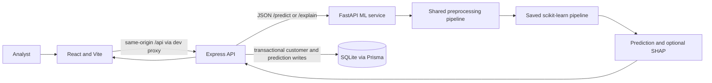

# ChurnWise: Explainable Customer Churn Prediction

ChurnWise is a local full-stack system that estimates telecom customer churn, records predictions, and presents SHAP explanations. It uses the repository's original dataset and saved model artifacts; Phase 8 adds verification, reproducible setup, and project documentation.

## 1. Problem Statement
Telecom providers need to identify customers who may leave and understand which account attributes influence a model's estimate. ChurnWise provides decision support, not a guarantee that an individual customer will churn.

## 2. Objectives
- Inspect and preprocess the supplied customer dataset.
- Compare ten binary classifiers with stratified hold-out evaluation and five-fold cross-validation.
- Persist reusable fitted pipelines and provide global/local SHAP explanations.
- Expose prediction and explanation services through FastAPI and Express.
- Store customers and prediction history in SQLite and present results in React.

## 3. Key Features
- EDA plots and documented data-quality findings.
- Validated customer prediction and risk banding.
- SHAP feature contributions for supported models.
- SQLite-backed customer and prediction history.
- Dashboard aggregates, recent predictions, customer listing, and API health.
- Responsive React interface with loading, validation, empty, and error states.

## 4. Technology Stack
- Python, pandas, NumPy, scikit-learn, XGBoost, SHAP, joblib, Matplotlib, and Seaborn.
- FastAPI and Uvicorn for model inference and explanations.
- Node.js, Express, Zod, Prisma, and SQLite for application API and persistence.
- React, Vite, JavaScript, Recharts, and Lucide icons for the browser client.
- Vitest/Testing Library, Node's test runner/Supertest, and FastAPI TestClient for checks.

## 5. Dataset
The project uses `WA_Fn-UseC_-Telco-Customer-Churn.csv` from the repository without replacing it. It has 7,043 rows and 21 columns, including the `Churn` target. Raw target counts are 5,174 `No` and 1,869 `Yes`; there are no duplicate rows. `TotalCharges` contains 11 blank or non-numeric entries.

## 6. Dataset Preprocessing
`ml/src/preprocessing.py` removes `customerID`, converts `TotalCharges` to numeric while retaining invalid values as missing, and then performs the existing 80/20 stratified split (5,634 train, 1,409 test). Inside each fitted model pipeline, a numeric conversion step precedes `SimpleImputer(strategy="median")`; the imputer is fitted on `X_train` only and that learned median transforms `X_test`. The other numeric fields are imputed/scaled, categorical values are imputed/one-hot encoded, and the transformed representation remains 45 columns.

## 7. EDA Findings
The target is imbalanced (about 73.5% no-churn and 26.5% churn). `customerID` is an identifier rather than a predictive input. EDA outputs include target distribution, tenure/charge distributions, categorical feature comparisons, and a correlation heatmap in `ml/results/eda/`. See [docs/eda_report.md](docs/eda_report.md).

## 8. ML Algorithms
The evaluated classifiers are Logistic Regression, K-Nearest Neighbors, Naive Bayes, Decision Tree, calibrated Support Vector Machine, Random Forest, AdaBoost, Gradient Boosting, MLP, and XGBoost. Ten fitted joblib pipelines are stored in `ml/models/`.

## 9. Evaluation Method
Training uses `train_test_split(test_size=0.2, random_state=42, stratify=y)`. The training code also runs shuffled 5-fold `StratifiedKFold` cross-validation, recording mean ROC-AUC and F1 on the training split. Held-out test metrics are accuracy, precision, recall, F1, ROC-AUC, and confusion-matrix counts. ROC curves, confusion-matrix plots, and metric comparison plots are saved under `ml/results/`.

## 10. Model Comparison
The table is from `ml/results/model_comparison.csv`, rounded to three decimals. Test ROC-AUC is highest for Gradient Boosting (0.843); test F1 is highest for AdaBoost (0.627). These rankings differ, so there is no single best model for every objective.

| Model | Accuracy | Precision | Recall | F1 | ROC-AUC | CV ROC-AUC mean | CV F1 mean |
|---|---:|---:|---:|---:|---:|---:|---:|
| Logistic Regression | 0.738 | 0.504 | 0.783 | 0.614 | 0.841 | 0.846 | 0.628 |
| KNN | 0.779 | 0.600 | 0.505 | 0.549 | 0.814 | 0.811 | 0.553 |
| Naive Bayes | 0.695 | 0.459 | 0.837 | 0.593 | 0.807 | 0.821 | 0.597 |
| Decision Tree | 0.732 | 0.495 | 0.487 | 0.491 | 0.654 | 0.663 | 0.505 |
| SVM | 0.789 | 0.601 | 0.615 | 0.608 | 0.826 | 0.832 | 0.608 |
| Random Forest | 0.766 | 0.552 | 0.623 | 0.585 | 0.822 | 0.823 | 0.601 |
| AdaBoost | 0.759 | 0.532 | 0.765 | 0.627 | 0.819 | 0.814 | 0.616 |
| Gradient Boosting | 0.806 | 0.674 | 0.524 | 0.589 | 0.843 | 0.848 | 0.590 |
| MLP | 0.751 | 0.529 | 0.564 | 0.546 | 0.775 | 0.771 | 0.529 |
| XGBoost | 0.796 | 0.644 | 0.513 | 0.571 | 0.839 | 0.840 | 0.571 |

## 11. SHAP Explainable AI
SHAP global bar/summary plots and local waterfall plots were generated for Gradient Boosting and Logistic Regression; the six artifacts are in `ml/results/shap/`. FastAPI `/explain` returns top local contributors for supported models. Contribution sign describes movement in model output, not a causal effect. See [docs/explainability_report.md](docs/explainability_report.md).

## 12. System Architecture


## 13. Backend Architecture
The browser uses a centralized API client. Express validates the 19 feature fields, forwards requests to FastAPI, validates responses, and transactionally stores the customer and prediction. The Vite development proxy forwards `/api` requests to Express; React does not call FastAPI directly. FastAPI loads saved artifacts and does not train on startup.

## 14. Database Design
Prisma defines `User`, `Customer`, and `Prediction`. A user may relate to many customers; a customer may have many predictions. `customerID` is optional and unique when provided. Each prediction stores result, probability, risk, model, and timestamp. Authentication is not implemented. See [docs/database_design.md](docs/database_design.md).

## 15. API Endpoints
FastAPI: `GET /health`, `GET /models`, `POST /predict`, `POST /explain`.

Express: `GET /api/health`, `POST /api/predictions`, `POST /api/explanations`, `GET /api/predictions`, `GET /api/customers`, and `GET /api/dashboard/stats`. See [docs/api_documentation.md](docs/api_documentation.md) for schemas and examples.

## 16. Frontend Modules
`frontend/src/App.jsx` contains Overview, Customer Prediction, Explainability, History, Customers, and About views. `frontend/src/api.js` is the single API client. `frontend/src/DashboardCharts.jsx` lazy-loads outcome and risk charts. `frontend/src/data.js` defines feature choices and database-to-form mapping; `frontend/src/styles.css` provides responsive styling.

## 17. Installation
Prerequisites: Python 3.10+, Node.js 20+, and npm. From the project root in PowerShell:

```powershell
py -m venv .venv
.\.venv\Scripts\python.exe -m pip install -r requirements.txt
cd backend
Copy-Item .env.example .env
npm install
npm run db:generate
npm run db:migrate -- --name init
cd ..\frontend
Copy-Item .env.example .env
npm install
```

Copy the root `.env.example` to `.env` if overriding FastAPI settings. Local environment files are ignored; keep the `.env.example` templates.

## 18. Run the Complete System
Run each service in a separate terminal. Start FastAPI from the project root; start Express from `backend/`; start Vite from `frontend/`:

```powershell
# Terminal 1: from the project root
.\.venv\Scripts\python.exe -m uvicorn ml.src.fastapi_app:app --host 127.0.0.1 --port 8000

# Terminal 2: from the project root
cd backend
npm start

# Terminal 3: from the project root
cd frontend
npm run dev -- --host 127.0.0.1
```

Defaults are FastAPI `127.0.0.1:8000`, Express `127.0.0.1:3001`, and Vite `127.0.0.1:5173` (Vite selects another port if that port is occupied). The frontend proxy target is configurable with `VITE_API_PROXY_TARGET`; the Express-to-FastAPI URL and SQLite URL are configured in `backend/.env`. Prisma resolves `file:./dev.db` relative to `backend/prisma/schema.prisma`, creating `backend/prisma/dev.db`.

## 19. Testing
Run from the indicated directories:

```powershell
# Project root
.\.venv\Scripts\python.exe tests\test_ml_pipeline.py
.\.venv\Scripts\python.exe tests\test_api.py

# backend/
npm test

# frontend/
npm test
npm run build
```

`test_ml_pipeline.py` checks the real CSV, cleaning/split dimensions, metric columns, and inference from saved artifacts; it does not retrain classifiers. See [docs/testing_report.md](docs/testing_report.md) for the latest integration run.

## 20. Limitations
- Evaluation uses one stratified hold-out split; cross-validation runs on the training partition. Results are dataset-specific and are not production validation.
- The target is imbalanced; consider recall, precision, F1, and ROC-AUC alongside accuracy.
- `TotalCharges` median imputation is now fitted inside each pipeline on `X_train` and reused for `X_test`; the regression test confirms the training median (`1398.125`) differs from and replaces the former full-data median (`1397.475`).
- SHAP plots were generated for Gradient Boosting and Logistic Regression. SHAP values describe model output, not causality.
- Local SQLite is suitable for development, not concurrent production workloads. Authentication, authorization, deployment, and monitoring are not implemented.
- `npm audit --omit=dev` currently reports three high-severity advisories in a Prisma/deepmerge-ts transitive dependency path; assess and update it safely before deployment.
- Risk cutoffs are configured defaults: below 0.33 Low, 0.33 to below 0.66 Medium, and 0.66 or above High.

## 21. Future Scope
Potential next steps include temporal/external validation, threshold calibration tied to retention capacity, protected-attribute/fairness analysis, database backup/retention policies, authentication, and deployment hardening. These are not part of the current implementation.

## 22. Documentation Index
- [Project overview](docs/project_overview.md)
- [System architecture](docs/system_architecture.md)
- [ML pipeline](docs/ml_pipeline.md)
- [API documentation](docs/api_documentation.md)
- [Database design](docs/database_design.md)
- [Testing report](docs/testing_report.md)
- [EDA report](docs/eda_report.md)
- [Model training report](docs/model_training_report.md)
- [Explainability report](docs/explainability_report.md)

## 23. Conclusion
ChurnWise connects the inspected telecom dataset and saved model comparison to a usable, explainable local application. Final verification confirmed churn and no-churn outcomes, SHAP output, persistent history, customer listing, and matching dashboard aggregates without retraining the classifiers.
