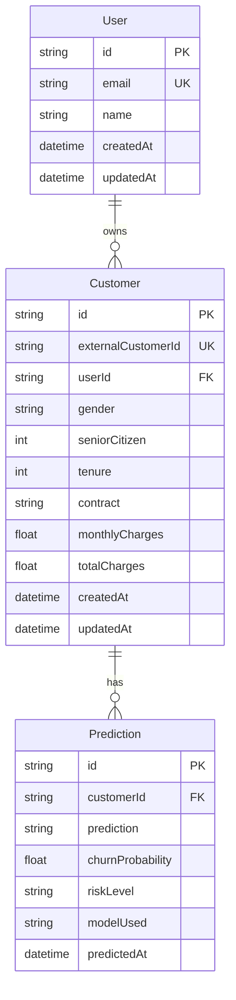

# Database Design

## Engine and ORM
SQLite is the initial database and Prisma is the ORM. The schema is `backend/prisma/schema.prisma`; the initial migration is under `backend/prisma/migrations/`. With `DATABASE_URL="file:./dev.db"`, Prisma stores the development database beside the schema at `backend/prisma/dev.db`. Database files and SQLite sidecars are ignored; migration SQL is retained.

## Models
- **User**: `id`, unique `email`, optional `name`, and timestamps. It is a profile relation only; authentication is not implemented.
- **Customer**: optional unique `externalCustomerId`, optional `userId`, all 19 churn features, and timestamps.
- **Prediction**: required customer relation, classification string, churn probability, risk level, model name, and `predictedAt` timestamp.

## Relationships

## Persistence Behavior
`POST /api/predictions` invokes FastAPI first. On successful response, Express wraps customer creation/upsert and prediction creation in a Prisma transaction. A provided external ID updates the customer's current feature values and appends a separate prediction record. A missing external ID creates a distinct customer record. Deleting a customer cascades to its predictions; deleting a user leaves customers with a null `userId`.

## Indexes
The schema indexes customer `userId`, prediction `(customerId, predictedAt)`, prediction outcome, and risk level to support common relationships and aggregate/history operations.

## Operational Notes
The local database currently includes verification records created by the end-to-end tests. It was preserved. SQLite is appropriate for local development; production concurrency, backups, retention, and access control are not configured.