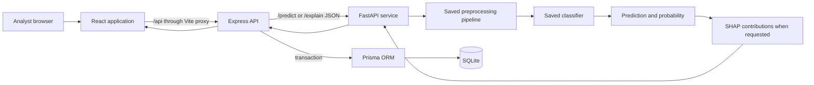
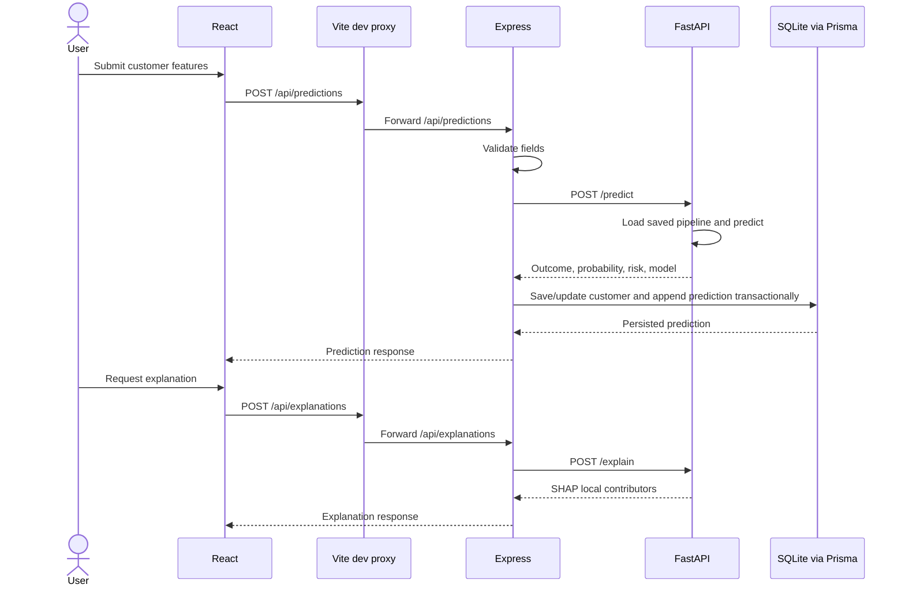

# System Architecture

## Components
- **React/Vite:** browser interface and centralized API client. It calls only Express routes. In local development Vite proxies same-origin `/api` requests to Express.
- **Express:** request validation, FastAPI HTTP client, history/customer/statistics routes, and Prisma transactions.
- **FastAPI:** loads existing joblib model artifacts, applies their embedded preprocessing, returns predictions, and runs SHAP for supported estimators.
- **Prisma/SQLite:** persists users (profile model only), customers, and prediction records.

## System Diagram

## Prediction Request Sequence

## Boundaries and Configuration
React does not connect directly to FastAPI or SQLite. Configure `VITE_API_PROXY_TARGET` in `frontend/.env`, `ML_SERVICE_URL` and `DATABASE_URL` in `backend/.env`, and FastAPI host/model/risk settings in the root `.env`. FastAPI loads saved estimators and does not retrain at startup.

## Failure Behavior
Express validates customer data before calling FastAPI. Invalid input returns HTTP 400; unavailable or invalid upstream ML responses return HTTP 502. Database and unexpected errors return an API error response. The UI presents request errors and retry actions where applicable.